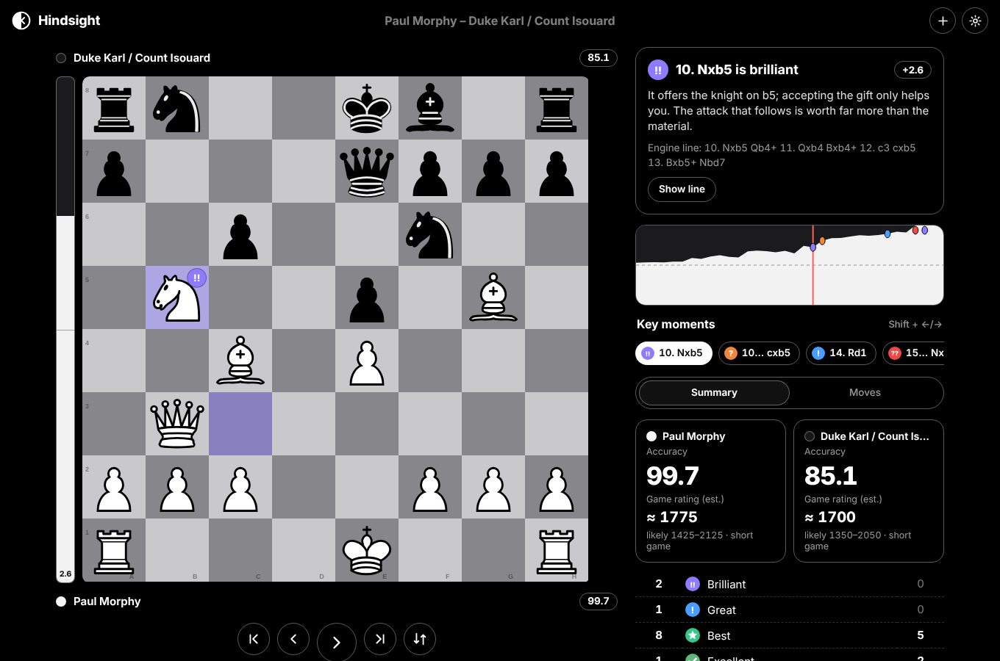
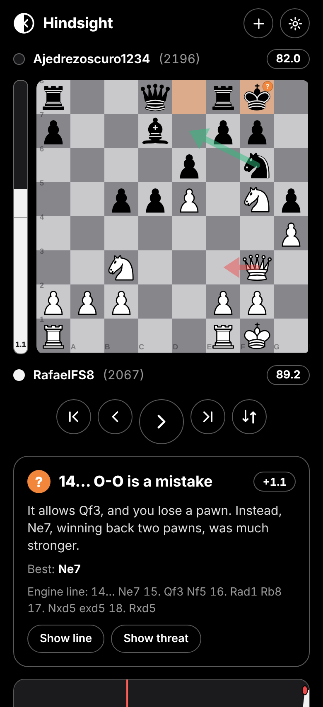

# Hindsight — on-device chess game review

Paste a PGN and get a full game review: an evaluation bar, a classification for every move
(Brilliant → Blunder, plus Book / Forced / Great / Miss), accuracy for both players, an
estimated game rating, plain-language explanations, best-move and threat arrows, an
evaluation graph and key moments.

**Everything runs on your device.** Stockfish 18 (WebAssembly) analyses the game in Web
Workers — several engines in parallel, one position each; there is no server and no network
call in the review path. A typical 40-move game reviews in ~20 s on a 4-core laptop (Standard). After the first visit the
app works fully offline (PWA).

<p>
  
  
</p>

The visual language follows two sibling apps, [openplayer](https://github.com/parthibdebnath/openplayer)
and [easySSH](https://github.com/parthibdebnath/easySSH): one user-chosen background colour
(pure black by default) with a single content colour, every other tone mixed from the two,
Inter type, outlined pills and round "orb" buttons, dotted dividers and optional frosted glass.
Colour is reserved for meaning (move classes, danger).

---

## Quick start

```bash
npm install
```

```bash
npm run dev        # http://localhost:5173
```

```bash
npm run build && npm run preview   # production build in dist/, served on :4173
```

```bash
npm test           # unit + full-game snapshot tests (no engine needed)
```

Node 20+ is required. `npm run dev`/`build` copy the Stockfish WASM files from
`node_modules/stockfish` into `public/engine/` (git-ignored) automatically.

### Command-line tools (same pipeline, Node + the same WASM engine)

| Command | What it does |
| --- | --- |
| `npm run review -- game.pgn [--preset fast\|standard\|deep] [--fixture]` | Review a PGN in the terminal; `--fixture` records engine output for tests |
| `npm run validate -- [--games 30] [--preset …] [--multipv N] [--no-adaptive]` | Cross-check accuracy and judgments against Lichess on rated games |
| `npm run calibrate -- [.data/lichess-evals.pgn]` | Fit the rating model (`src/data/rating-model.json`) |
| `npm run openings` | Rebuild `src/data/openings.json` from the Lichess openings TSVs |
| `npx vite-node tools/judge-variants.ts` | Compare ways of measuring a move's loss against Lichess |

## Hosting

Any static host works: `dist/` is plain files. The default engine setup (a pool of
single-threaded engines, see DECISIONS.md D-ENG-7) needs no special headers.

The **optional** multi-threaded engine (Settings → "One multi-threaded engine") needs
`SharedArrayBuffer`, which browsers only enable on cross-origin isolated pages:

```
Cross-Origin-Opener-Policy: same-origin
Cross-Origin-Embedder-Policy: require-corp
```

- **Netlify / Cloudflare Pages**: already handled by `public/_headers` (copied into `dist/`).
- **Vercel**: already configured in `vercel.json` (build command, output folder, headers, caching). Deploy with `vercel deploy --prod`.
- **nginx**: `add_header Cross-Origin-Opener-Policy same-origin; add_header Cross-Origin-Embedder-Policy require-corp;`
- **Hosts without header control (e.g. GitHub Pages)**: the service worker re-serves cached
  files with both headers, so the page becomes isolated from the second load on.

Without isolation the setting is simply unavailable. Vite's dev and preview servers send the
headers (`vite.config.ts`).

## How it works

```
PGN ──► positions ──► engine analysis (cached) ──► classify / accuracy / rating ──► explanations ──► UI
 src/core/pgn     src/engine/analyzer+cache       src/core/{classify,accuracy,rating}  src/core/{features,explain}  src/ui
```

- **`src/core`** — pure, unit-tested logic with no browser APIs.
  - `winpct.ts` win probability `50 + 50·(2/(1+e^(−0.00368208·cp)) − 1)`; mate = 100/0 for
    the bar and classification, ±1000 cp (Lichess convention) for accuracy.
  - `accuracy.ts` per-move accuracy `103.1668·e^(−0.04354·Δ) − 3.1669 + 1` and game accuracy
    = mean of the volatility-weighted mean and the harmonic mean (Lichess's open method).
  - `classify.ts` + `config.ts` expected-points loss → Best/Excellent/Good/Inaccuracy/Mistake/
    Blunder, then Forced, Book, Brilliant, Great, Miss. All thresholds live in one config object.
  - `features.ts` deterministic facts: captures/trades, checks/mates, forks, pins, skewers,
    discovered attacks/checks, mate threats, new threats, hanging pieces, escapes, castling,
    development, centre play, king-safety and castling-rights changes, passed pawns, material
    swings along engine lines. `board.ts` has the geometry and a fast static-exchange evaluator.
  - `explain.ts` templates with several phrasings each (picked by a hash of the ply, so output
    is stable but varied). Every claim comes from a fact or an engine line.
  - `rating.ts` the rating estimator (gradient-boosted trees, JSON model).
  - `review.ts` assembles everything; memoised per move so streaming updates are cheap.
- **`src/engine`** — `EngineAdapter` (init / setOption / analyze / stop / newGame / dispose),
  a UCI driver, the Web Worker adapter, a Node adapter for tools/tests, the analysis queue
  (adaptive depth, progress, ETA, cancel) and the IndexedDB cache.
- **`src/ui`** — React components. Results stream in; you can browse while analysis runs.
- **`tools/`** — data and calibration scripts (Node). **`tests/`** — Vitest suites and fixtures.

### Engine presets

| Preset | Depth | Notes |
| --- | --- | --- |
| Fast | 12 | MultiPV 2; auto-selected on phones/tablets |
| Standard | 16 | MultiPV 3; default. A 40-move game: ~20 s with 3–4 engines, ~60 s with one |
| Deep | 20 | MultiPV 3; slowest, closest to server-side analysis |

MultiPV is also selectable (2 or 3) in Settings. Engines: min(cores − 1, 4) parallel
single-threaded engines (adjustable). **Adaptive depth** searches book moves (≤12),
single-reply positions (≤10) and already-decided positions (−3 plies when |eval| ≥ 6 pawns)
less deeply.

Analysis is cached per game + engine settings in IndexedDB (partial results too, so an
interrupted review resumes). Review history is kept locally.

## Tuning guide

- **Thresholds**: `src/core/config.ts` (`DEFAULT_CONFIG`). The Settings sheet exposes the four
  base thresholds and Strict/Normal/Generous presets for Brilliant and Great
  (`withSensitivity`).
- **Brilliant** = a sound piece sacrifice (see `findSacrifice`): the mover gives up at least
  `minSacrifice` pawns of material net (a piece, never a pawn), the move is best or within
  `maxLoss`, the best *alternative* isn't already winning (`maxWinBefore`), and the position
  afterwards is still at least `minWinAfter`.
- **Great** = the only move that holds (gap to the second line ≥ `onlyMoveGap`) or a turning
  point; never for mates, recaptures, captures of loose pieces, escaping check or retreating
  an attacked piece.
- **Miss** = loses ≥ `miss.minLoss` while a big chance existed, right after an opponent's
  mistake/blunder (and without dropping below where you were), or a missed forced mate.
- Measure changes: `npm run validate` (agreement with Lichess) and `npm test` (snapshots of
  8 full games show exactly which moves changed: run `npx vitest -u` to accept).

## Rating calibration

The estimate is fitted on rated games from the open Lichess database (CC0) that carry
server-analysis evals:

```bash
pip install zstandard
```

```bash
python3 tools/scripts/sample_lichess.py --month 2025-06 --games 100000 --out .data/lichess-evals-100k.pgn
```

```bash
npm run calibrate -- .data/lichess-evals-100k.pgn
```

The script streams only the start of the month's `.pgn.zst` (≈10% of games have evals),
computes the same features the app computes (accuracy, ACPL, error rates, accuracy and ACPL
in still-contested positions, the opponent's accuracy/ACPL, length, time control), compares
ridge regression with gradient-boosted trees on a held-out 20%, and writes the better model.
Current model: 199,734 player-games, test MAE ≈ 290 Elo (vs 350 for guessing the mean),
R² ≈ 0.31. One game says little about strength, so the UI shows a ~50% range and labels it
an estimate. Ratings are on the **Lichess scale**.

## Validation against Lichess

`tools/validate.ts` picks rated Lichess games across rating bands and compares our review
with Lichess's own server analysis of the same games (its evals and its ?!/?/?? judgments).
Results are summarised in `DECISIONS.md`. Headline (Standard preset, lite NNUE, 30 games,
60 player-games): accuracy within ~2.4 points (MAE) of Lichess's method on Lichess's evals;
82% of the moves Lichess flags are flagged by us and 86% of our flags are confirmed by Lichess.
Fast (depth 12) needed ~7 s per game with a single engine on the 4-vCPU test machine, with recall/precision
75/77%. Chess.com's exact
formulas are proprietary, so we can't validate against them directly.

## Swapping in a native engine (Tauri)

Everything talks to the engine through `EngineAdapter` (`src/engine/types.ts`), and the UCI
protocol is handled once in `UciEngine` (`src/engine/uci.ts`). A native Stockfish only needs
a transport. With Tauri v2's shell plugin and Stockfish bundled as a sidecar:

```ts
import { Command, type Child } from '@tauri-apps/plugin-shell';
import { UciEngine } from './uci';
import type { EngineInfo } from './types';

export class TauriEngine extends UciEngine {
  private child?: Child;
  protected post(cmd: string) { void this.child?.write(cmd + '\n'); }
  async init(): Promise<EngineInfo> {
    const cmd = Command.sidecar('binaries/stockfish');
    let buf = '';
    cmd.stdout.on('data', (chunk: string) => {
      buf += chunk;
      let i: number;
      while ((i = buf.indexOf('\n')) >= 0) { this.receive(buf.slice(0, i).trim()); buf = buf.slice(i + 1); }
    });
    this.child = await cmd.spawn();
    await this.request('uci', (l) => l === 'uciok');
    this.setOption('Threads', 4);
    this.setOption('Hash', 256);
    await this.isReady();
    return (this.info = { name: 'Stockfish (native)', id: 'sf-native', threads: 4, multiThreaded: true });
  }
  dispose() { void this.child?.kill(); }
}
```

Then at startup, when running inside Tauri:
`setEngineFactory(() => new TauriEngine())` (`src/engine/service.ts`). The cache key includes
the engine id, so native and WASM results never mix. Native Stockfish with the full NNUE net
is several times faster and stronger, which makes Deep reviews quick. (Bundling the Stockfish
binary keeps the app under GPLv3 — see below.)

## Optional online features (off by default)

- **Import from a Lichess link** (Settings → Online extras). Uses Lichess's public export
  endpoint; any failure shows a message and you can paste the PGN instead. Chess.com offers no
  single-game export to other sites, so the app explains how to copy the PGN there.
- **Polish wording with an LLM**: sends one move's verified facts (classification, engine
  best move/line, detected tactics, the draft sentence — not raw positions or your whole game)
  to an OpenAI-compatible endpoint you configure (e.g. a local Ollama server), only when you
  press the button. Failures keep the built-in text.

## Accessibility

Classification marks differ by **shape** (!!, !, star, check, ring, book, arrow, ?!, ?, slashed
ring, ??) and carry text labels; colour is a secondary cue and a monochrome mode is available.
Everything is keyboard-operable: ←/→ moves, Shift+←/→ key moments, Home/End or ↑/↓ start/end,
F flips, Esc leaves a line. The eval bar is a labelled meter, the graph a slider, the commentary
an `aria-live` region; reduced-motion is respected.

## Licenses and what they mean for distribution

Hindsight is **GPL-3.0-or-later** (see `LICENSE`), because it bundles GPLv3 components:

- **Stockfish** — GPLv3. Source: https://github.com/official-stockfish/Stockfish. WASM build:
  **stockfish.js** by Nathan Rugg / Chess.com, GPLv3, https://github.com/nmrugg/stockfish.js
  (license text shipped as `engine/COPYING.txt`).
- **chessground** (board) — GPL-3.0-or-later, https://github.com/lichess-org/chessground.
  Piece set "cburnett" by Colin M.L. Burnett — GPLv2+.

What this means: anyone may use, modify and redistribute the app, but if you distribute it
(including hosting a modified version for download, an app-store build, or a Tauri binary) you
must provide the complete corresponding source under GPLv3, keep the license notices, and
can't add restrictions. Hosting the unmodified app is simplest: link to this repository.

Data: opening names from **lichess-org/chess-openings** (CC0, public domain dedication;
credit appreciated) and the rating model was fitted on the **Lichess open database**
(https://database.lichess.org, CC0). Other dependencies (React MIT, chess.js BSD-2-Clause,
idb ISC, Inter OFL-1.1) are listed in `LICENSES.md`.

Branding, icons, colours and wording are original to this project.
